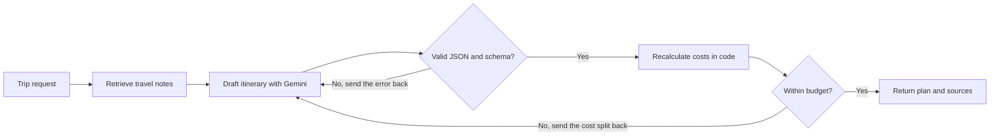

# AI Travel Planner & Cost Optimizer

Generates day-by-day travel itineraries that fit a budget, using Gemini, retrieval over local travel notes, and strict output validation.

The model can return broken JSON or get its sums wrong, so this project does not trust its output. Every reply is validated against a schema, invalid replies are sent back with the exact error, and all costs are recalculated in code.

## How it works



1. **Retrieve:** guides in `data/destinations` are split by section, embedded with Gemini embeddings and searched per destination.
2. **Draft:** the model receives the notes and the trip details, and must reply with one JSON object.
3. **Validate and repair:** Pydantic and a day-number check validate the reply. On failure, the error goes back to the model, for up to 3 attempts.
4. **Optimize cost:** the total is calculated in code. If it is over budget, the model gets the cost split and rewrites the plan, up to 2 times. If it is still over, the response says so instead of hiding it.

## Project structure

```text
ai-travel-planner/
├── app/
│   ├── api.py          # FastAPI routes
│   ├── budget.py       # Cost totals and budget revision prompt
│   ├── config.py       # Settings from .env
│   ├── factory.py      # Builds the planner with Gemini
│   ├── knowledge.py    # Chunking and retrieval
│   ├── planner.py      # Draft, validate, repair and revise loop
│   └── schemas.py      # Request and response models
├── data/destinations/  # Sample travel notes
├── evals/              # Reliability measurement on the real model
├── tests/              # Tests with a fake model, no API key needed
└── ui/streamlit_app.py # Web interface
```

## Setup

Tested on Python 3.14. Requires a [Gemini API key](https://aistudio.google.com/apikey).

```bash
python -m venv .venv
.venv\Scripts\activate
pip install -r requirements.txt
copy .env.example .env
```

Then add your key to `.env`.

## Run

Start the API, then the interface in a second terminal:

```bash
uvicorn app.api:app --reload
streamlit run ui/streamlit_app.py
```

API docs are at http://127.0.0.1:8000/docs. Example request:

```bash
curl -X POST http://127.0.0.1:8000/plan -H "Content-Type: application/json" -d "{\"destination\": \"Goa\", \"days\": 3, \"travellers\": 2, \"budget_inr\": 30000, \"interests\": [\"beaches\", \"food\"]}"
```

## Tests

```bash
pytest
```

The tests use a fake model, so they need no API key and cost nothing. They cover JSON extraction, the repair loop, budget revisions, retrieval filtering, the API and the interface.

## Reliability

`evals/measure_reliability.py` runs the real model on the requests in `evals/requests.jsonl` and writes `evals/results.json`:

```bash
python -m evals.measure_reliability --repeats 3 --delay 7
```

Latest run on `gemini-3.1-flash-lite`: 10 trip requests, 3 runs each.

| Metric | Result |
|---|---|
| Valid itineraries | 30 of 30 |
| Valid with no repair needed | 30 of 30 |
| Final plan within budget | 30 of 30 |

This is a small test. It shows that the output format and budget totals held up, not that the travel advice is accurate. Rate limit and outage errors are recorded separately and not scored, and there were none in this run.

## Limitations

- The notes cover only Goa, Jaipur and Munnar. Other destinations still work, but with no retrieved notes.
- Costs in the notes and itineraries are estimates, so check prices before booking.
- Costs exclude travel to the destination.
- The vector store is in memory, so it is rebuilt each time the API starts.
